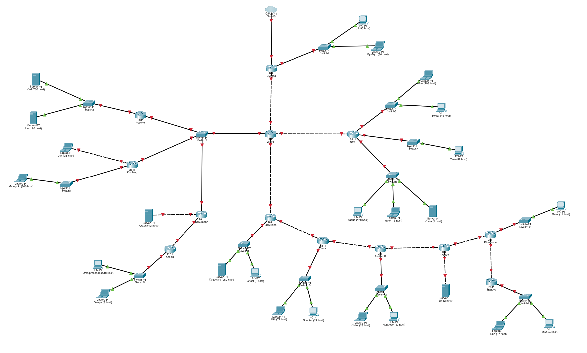
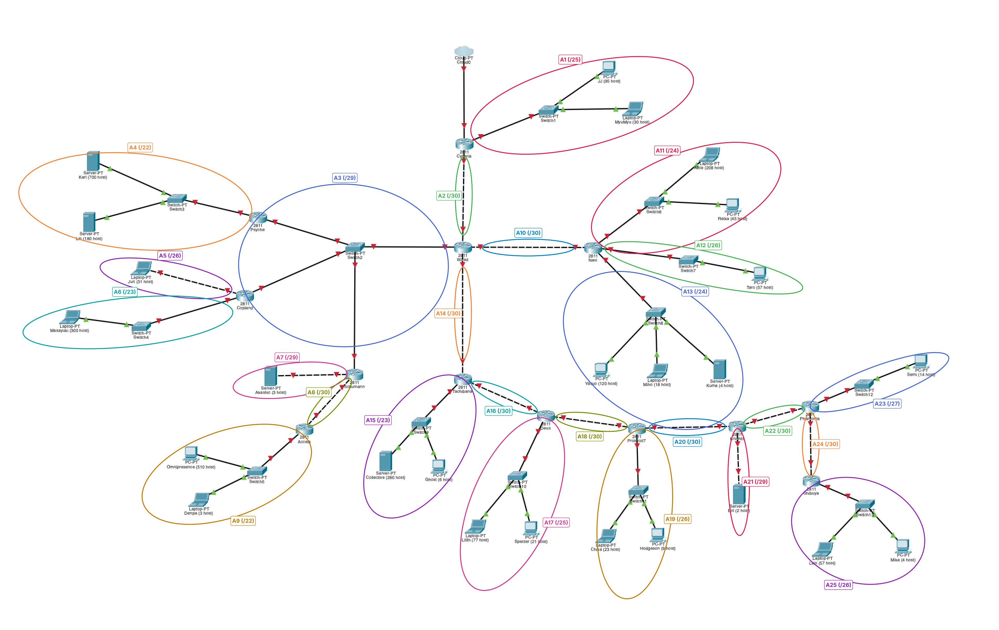
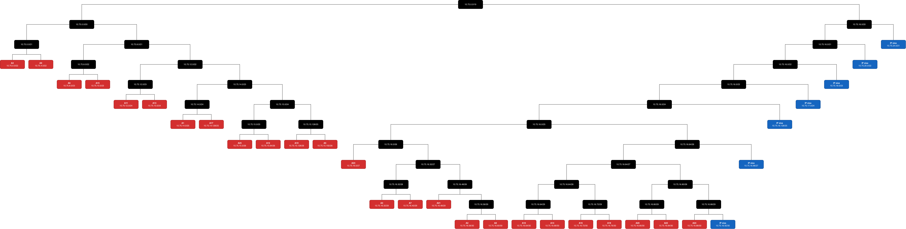
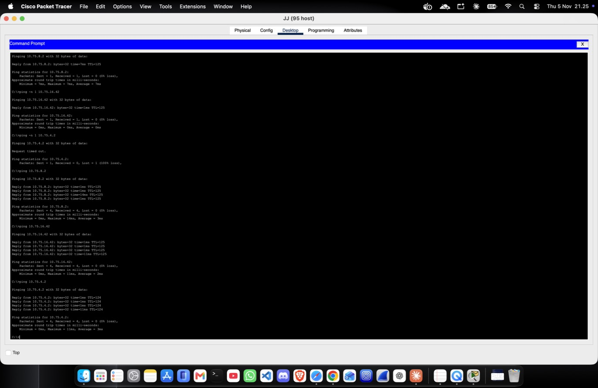
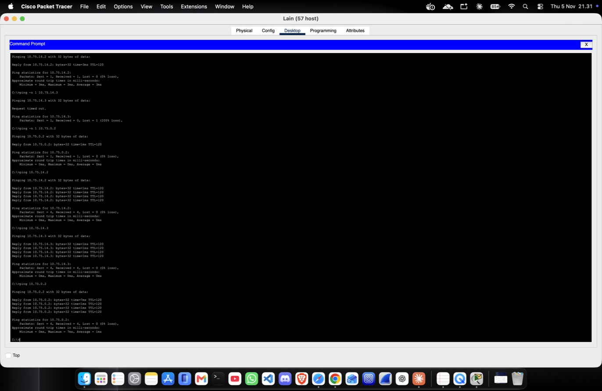
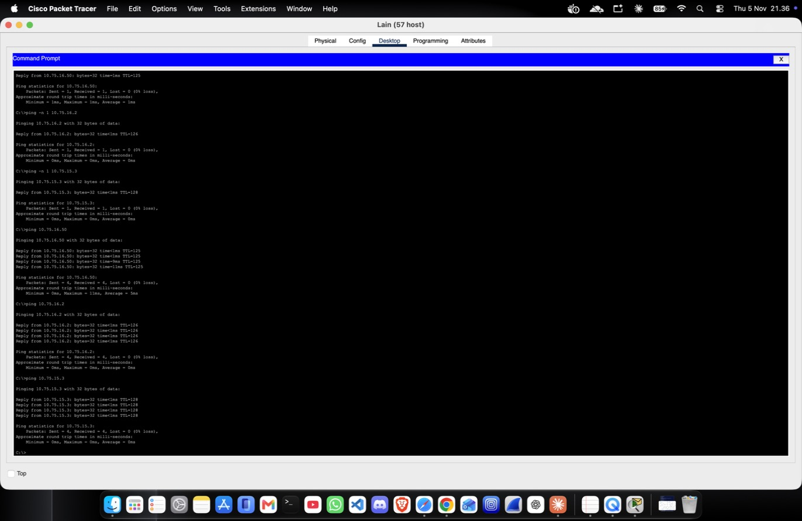
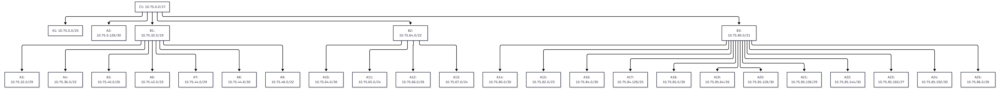

# Praktikum Komunikasi Data & Jaringan Komputer — Modul 4
## Kelompok K23 · Prefix IP `10.75.0.0`

| Nama | NRP | Bagian |
|---|---|---|
| Naoval James Osamah | 5027251092 | Cisco Packet Tracer — **VLSM** |
| Nur Rizki Syahbana | _(NRP)_ | GNS3 — **CIDR** |

Sesuai ketentuan soal, CPT dan GNS3 memakai metode classless yang berbeda: **VLSM di CPT** dan **CIDR di GNS3**.

---

## Daftar Isi
1. [Struktur Repository](#1-struktur-repository)
2. [Topologi](#2-topologi)
3. [Pembagian Subnet (Rute)](#3-pembagian-subnet-rute)
4. [Perhitungan VLSM (CPT)](#4-perhitungan-vlsm-cpt)
5. [Tree VLSM](#5-tree-vlsm)
6. [Konfigurasi Cisco Packet Tracer](#6-konfigurasi-cisco-packet-tracer)
7. [Routing Statis](#7-routing-statis)
8. [Pengujian (Ping)](#8-pengujian-ping)
9. [Perhitungan CIDR (GNS3)](#9-perhitungan-cidr-gns3)

---

## 1. Struktur Repository

```
Jarkom-Modul-4-2026-K-23/
├── README.md
├── Jarkom-Modul-4-2026-K-23.xlsx        # Spreadsheet perhitungan (Rute, VLSM, CIDR)
├── images/
│   ├── topologi/                        # Topologi CPT (polos dan dengan penanda subnet)
│   ├── tree/                            # Tree VLSM dan Tree CIDR
│   └── ping/                            # Screenshot hasil ping (01–16)
├── modul 4 jarkom VLSM cisco/
│   └── Jarkom-Modul-4-2026-K-23.pkt     # File Cisco Packet Tracer
└── modul 4 jarkom CIDR GNS3/
    ├── CIDR K23.gns3project             # Project GNS3
    └── script.txt                       # Script konfigurasi node
```

---

## 2. Topologi

Topologi The Wired dibangun di Cisco Packet Tracer sesuai gambar soal. **Cyberia adalah satu-satunya router yang terhubung ke Cloud**, dan jumlah host tiap node tertulis pada nama perangkat (contoh: `JJ (95 host)`).



Topologi yang sama dengan penanda setiap subnet (A1–A25) beserta prefix-nya:



**Perangkat:**
- 13 router Cisco 2811. Router yang butuh lebih dari 2 port (Cyberia, Wired, Navi, Copland, Schumann, Tachibana, Deus, Protocol7, Knights, Phantoma) ditambah modul **NM-2FE2W** (port Fa1/0 dan Fa1/1).
- 13 switch, 25 node host, 1 Cloud.
- Kabel **cross-over** untuk router–router dan router–node langsung (Juri, Akashic, Eiri); **straight-through** untuk sambungan lewat switch.

---

## 3. Pembagian Subnet (Rute)

Satu subnet adalah sekumpulan perangkat yang terhubung **tanpa melewati router**. Sesuai poin 8 soal:

> **Jumlah IP = jumlah host + jumlah interface router pada subnet tersebut**

Netmask dipilih dari jumlah bit host terkecil `n` yang memenuhi **2ⁿ − 2 ≥ jumlah IP**, lalu prefix = 32 − n.

| Subnet | Rute | Perhitungan | Jumlah IP | Netmask |
|---|---|---|---|---|
| A1 | Cyberia > Switch1 > JJ, MyuMyu | 95 + 30 + 1 | 126 | /25 |
| A2 | Cyberia > Wired | 2 router | 2 | /30 |
| A3 | Wired > Switch2 > Psyche, Copland, Schumann | 4 router | 4 | /29 |
| A4 | Psyche > Switch3 > Karl, Lin | 700 + 180 + 1 | 881 | /22 |
| A5 | Copland > Juri | 31 + 1 | 32 | /26 |
| A6 | Copland > Switch4 > Masayuki | 300 + 1 | 301 | /23 |
| A7 | Schumann > Akashic | 3 + 1 | 4 | /29 |
| A8 | Schumann > Accela | 2 router | 2 | /30 |
| A9 | Accela > Switch5 > Omnipresence, Denpa | 510 + 3 + 1 | 514 | /22 |
| A10 | Wired > Navi | 2 router | 2 | /30 |
| A11 | Navi > Switch6 > Alice, Reika | 208 + 45 + 1 | 254 | /24 |
| A12 | Navi > Switch7 > Taro | 57 + 1 | 58 | /26 |
| A13 | Navi > Switch8 > Yasuo, Miho, Kuma | 120 + 18 + 4 + 1 | 143 | /24 |
| A14 | Wired > Tachibana | 2 router | 2 | /30 |
| A15 | Tachibana > Switch9 > Collective, Ghost | 260 + 6 + 1 | 267 | /23 |
| A16 | Tachibana > Deus | 2 router | 2 | /30 |
| A17 | Deus > Switch10 > Lilith, Specter | 77 + 21 + 1 | 99 | /25 |
| A18 | Deus > Protocol7 | 2 router | 2 | /30 |
| A19 | Protocol7 > Switch11 > Chisa, Hodgeson | 23 + 9 + 1 | 33 | /26 |
| A20 | Protocol7 > Knights | 2 router | 2 | /30 |
| A21 | Knights > Eiri | 2 + 1 | 3 | /29 |
| A22 | Knights > Phantoma | 2 router | 2 | /30 |
| A23 | Phantoma > Switch12 > Semi | 14 + 1 | 15 | /27 |
| A24 | Phantoma > Shibuya | 2 router | 2 | /30 |
| A25 | Shibuya > Switch13 > Lain, Mika | 57 + 4 + 1 | 62 | /26 |
| **Total** | | | **2814** | **/19** |

**Kenapa total /19, bukan /20?** Yang dijumlahkan adalah ukuran blok tiap subnet, bukan jumlah IP-nya:

| Prefix | Ukuran blok | Banyak | Total |
|---|---|---|---|
| /22 | 1024 | 2 | 2048 |
| /23 | 512 | 2 | 1024 |
| /24 | 256 | 2 | 512 |
| /25 | 128 | 2 | 256 |
| /26 | 64 | 4 | 256 |
| /27 | 32 | 1 | 32 |
| /29 | 8 | 3 | 24 |
| /30 | 4 | 9 | 36 |
| | | **Jumlah** | **4188** |

Blok /20 hanya berisi 4096 alamat (< 4188), sehingga dibutuhkan **/19 (8192 alamat)**.

---

## 4. Perhitungan VLSM (CPT)

Metode mengikuti Jeremy's IT Lab (CCNA Day 15 — Subnetting Part 3, VLSM):

1. Urutkan subnet dari kebutuhan IP **terbesar ke terkecil**.
2. Cari jumlah bit host `n` dengan 2ⁿ − 2 ≥ jumlah IP → prefix = 32 − n.
3. **Network ID** subnet pertama = `10.75.0.0`; subnet berikutnya dimulai **tepat setelah broadcast** subnet sebelumnya.
4. **Broadcast** = semua bit host bernilai 1.
5. **Range IP** = network + 1 sampai broadcast − 1.

### Contoh perhitungan biner

**A4 (/22), n = 10** — bit host masuk ke oktet ke-3:
```
Netmask   : 11111111.11111111.111111|00.00000000 = 255.255.252.0
Network   : 00001010.01001011.000000|00.00000000 = 10.75.0.0
Broadcast : 00001010.01001011.000000|11.11111111 = 10.75.3.255
```
Subnet berikutnya: 10.75.3.255 + 1 = **10.75.4.0**

**A1 (/25), n = 7:**
```
Netmask   : 11111111.11111111.11111111.1|0000000 = 255.255.255.128
Network   : 00001010.01001011.00001110.0|0000000 = 10.75.14.0
Broadcast : 00001010.01001011.00001110.0|1111111 = 10.75.14.127
```

**A2 (/30), n = 2:**
```
Netmask   : 11111111.11111111.11111111.111111|00 = 255.255.255.252
Network   : 00001010.01001011.00010000.001110|00 = 10.75.16.56
Broadcast : 00001010.01001011.00010000.001110|11 = 10.75.16.59
```

### Hasil pembagian IP VLSM

| Subnet | Jumlah IP | Prefix | Network ID | Netmask | Broadcast | Range IP |
|---|---|---|---|---|---|---|
| A4 | 881 | /22 | 10.75.0.0 | 255.255.252.0 | 10.75.3.255 | 10.75.0.1 - 10.75.3.254 |
| A9 | 514 | /22 | 10.75.4.0 | 255.255.252.0 | 10.75.7.255 | 10.75.4.1 - 10.75.7.254 |
| A6 | 301 | /23 | 10.75.8.0 | 255.255.254.0 | 10.75.9.255 | 10.75.8.1 - 10.75.9.254 |
| A15 | 267 | /23 | 10.75.10.0 | 255.255.254.0 | 10.75.11.255 | 10.75.10.1 - 10.75.11.254 |
| A11 | 254 | /24 | 10.75.12.0 | 255.255.255.0 | 10.75.12.255 | 10.75.12.1 - 10.75.12.254 |
| A13 | 143 | /24 | 10.75.13.0 | 255.255.255.0 | 10.75.13.255 | 10.75.13.1 - 10.75.13.254 |
| A1 | 126 | /25 | 10.75.14.0 | 255.255.255.128 | 10.75.14.127 | 10.75.14.1 - 10.75.14.126 |
| A17 | 99 | /25 | 10.75.14.128 | 255.255.255.128 | 10.75.14.255 | 10.75.14.129 - 10.75.14.254 |
| A25 | 62 | /26 | 10.75.15.0 | 255.255.255.192 | 10.75.15.63 | 10.75.15.1 - 10.75.15.62 |
| A12 | 58 | /26 | 10.75.15.64 | 255.255.255.192 | 10.75.15.127 | 10.75.15.65 - 10.75.15.126 |
| A19 | 33 | /26 | 10.75.15.128 | 255.255.255.192 | 10.75.15.191 | 10.75.15.129 - 10.75.15.190 |
| A5 | 32 | /26 | 10.75.15.192 | 255.255.255.192 | 10.75.15.255 | 10.75.15.193 - 10.75.15.254 |
| A23 | 15 | /27 | 10.75.16.0 | 255.255.255.224 | 10.75.16.31 | 10.75.16.1 - 10.75.16.30 |
| A3 | 4 | /29 | 10.75.16.32 | 255.255.255.248 | 10.75.16.39 | 10.75.16.33 - 10.75.16.38 |
| A7 | 4 | /29 | 10.75.16.40 | 255.255.255.248 | 10.75.16.47 | 10.75.16.41 - 10.75.16.46 |
| A21 | 3 | /29 | 10.75.16.48 | 255.255.255.248 | 10.75.16.55 | 10.75.16.49 - 10.75.16.54 |
| A2 | 2 | /30 | 10.75.16.56 | 255.255.255.252 | 10.75.16.59 | 10.75.16.57 - 10.75.16.58 |
| A8 | 2 | /30 | 10.75.16.60 | 255.255.255.252 | 10.75.16.63 | 10.75.16.61 - 10.75.16.62 |
| A10 | 2 | /30 | 10.75.16.64 | 255.255.255.252 | 10.75.16.67 | 10.75.16.65 - 10.75.16.66 |
| A14 | 2 | /30 | 10.75.16.68 | 255.255.255.252 | 10.75.16.71 | 10.75.16.69 - 10.75.16.70 |
| A16 | 2 | /30 | 10.75.16.72 | 255.255.255.252 | 10.75.16.75 | 10.75.16.73 - 10.75.16.74 |
| A18 | 2 | /30 | 10.75.16.76 | 255.255.255.252 | 10.75.16.79 | 10.75.16.77 - 10.75.16.78 |
| A20 | 2 | /30 | 10.75.16.80 | 255.255.255.252 | 10.75.16.83 | 10.75.16.81 - 10.75.16.82 |
| A22 | 2 | /30 | 10.75.16.84 | 255.255.255.252 | 10.75.16.87 | 10.75.16.85 - 10.75.16.86 |
| A24 | 2 | /30 | 10.75.16.88 | 255.255.255.252 | 10.75.16.91 | 10.75.16.89 - 10.75.16.90 |

Seluruh subnet tersusun rapat dari `10.75.0.0` sampai `10.75.16.91` **tanpa celah** (4188 alamat), di dalam blok `10.75.0.0/19`.

---

## 5. Tree VLSM

Blok `10.75.0.0/19` dibelah dua terus-menerus sampai setiap subnet mendapat tempat.
- **Hitam**: blok perantara (dibelah lagi)
- **Merah**: subnet yang dipakai (A1–A25)
- **Biru**: blok sisa (tidak dipakai)



---

## 6. Konfigurasi Cisco Packet Tracer

### Aturan pemberian IP
- Interface router pada subnet LAN memakai **first usable**, dan menjadi **gateway** node di subnet itu.
- Link router–router (/30): router yang lebih dekat ke Cyberia memakai first usable.
- A3 (Switch2, 4 router): Wired `.33`, Psyche `.34`, Copland `.35`, Schumann `.36`.
- Port `Fa0/0` Cyberia (ke Cloud) tidak diberi IP.

### Pemetaan port router

| Router | Fa0/0 | Fa0/1 | Fa1/0 | Fa1/1 |
|---|---|---|---|---|
| Cyberia | Cloud | Switch1 | Wired | — |
| Wired | Cyberia | Switch2 | Navi | Tachibana |
| Psyche | Switch2 | Switch3 | — | — |
| Copland | Switch2 | Juri | Switch4 | — |
| Schumann | Switch2 | Akashic | Accela | — |
| Accela | Schumann | Switch5 | — | — |
| Navi | Wired | Switch6 | Switch7 | Switch8 |
| Tachibana | Wired | Switch9 | Deus | — |
| Deus | Tachibana | Switch10 | Protocol7 | — |
| Protocol7 | Deus | Switch11 | Knights | — |
| Knights | Protocol7 | Eiri | Phantoma | — |
| Phantoma | Knights | Switch12 | Shibuya | — |
| Shibuya | Phantoma | Switch13 | — | — |

### Konfigurasi node (Desktop → IP Configuration → Static)

| Node | IP Address | Subnet Mask | Default Gateway |
|---|---|---|---|
| JJ | 10.75.14.2 | 255.255.255.128 | 10.75.14.1 |
| MyuMyu | 10.75.14.3 | 255.255.255.128 | 10.75.14.1 |
| Karl | 10.75.0.2 | 255.255.252.0 | 10.75.0.1 |
| Lin | 10.75.0.3 | 255.255.252.0 | 10.75.0.1 |
| Juri | 10.75.15.194 | 255.255.255.192 | 10.75.15.193 |
| Masayuki | 10.75.8.2 | 255.255.254.0 | 10.75.8.1 |
| Akashic | 10.75.16.42 | 255.255.255.248 | 10.75.16.41 |
| Omnipresence | 10.75.4.2 | 255.255.252.0 | 10.75.4.1 |
| Denpa | 10.75.4.3 | 255.255.252.0 | 10.75.4.1 |
| Alice | 10.75.12.2 | 255.255.255.0 | 10.75.12.1 |
| Reika | 10.75.12.3 | 255.255.255.0 | 10.75.12.1 |
| Taro | 10.75.15.66 | 255.255.255.192 | 10.75.15.65 |
| Yasuo | 10.75.13.2 | 255.255.255.0 | 10.75.13.1 |
| Miho | 10.75.13.3 | 255.255.255.0 | 10.75.13.1 |
| Kuma | 10.75.13.4 | 255.255.255.0 | 10.75.13.1 |
| Collective | 10.75.10.2 | 255.255.254.0 | 10.75.10.1 |
| Ghost | 10.75.10.3 | 255.255.254.0 | 10.75.10.1 |
| Lilith | 10.75.14.130 | 255.255.255.128 | 10.75.14.129 |
| Specter | 10.75.14.131 | 255.255.255.128 | 10.75.14.129 |
| Chisa | 10.75.15.130 | 255.255.255.192 | 10.75.15.129 |
| Hodgeson | 10.75.15.131 | 255.255.255.192 | 10.75.15.129 |
| Eiri | 10.75.16.50 | 255.255.255.248 | 10.75.16.49 |
| Semi | 10.75.16.2 | 255.255.255.224 | 10.75.16.1 |
| Lain | 10.75.15.2 | 255.255.255.192 | 10.75.15.1 |
| Mika | 10.75.15.3 | 255.255.255.192 | 10.75.15.1 |

---

## 7. Routing Statis

Topologi berbentuk pohon dengan Cyberia di puncak, sehingga routing dibuat seefisien mungkin dengan dua aturan:

1. **Default route (`0.0.0.0/0`) ke arah atas** (menuju Cyberia) pada setiap router selain Cyberia.
2. **Route spesifik ke arah bawah**, hanya untuk subnet di bawah router tersebut yang tidak terhubung langsung.

Cyberia cukup memiliki **satu route ringkasan** `10.75.0.0/19` ke Wired; subnet A1 dan A2 tetap dipakai langsung karena prefix-nya lebih spesifik. Router ujung (Psyche, Copland, Accela, Navi, Shibuya) cukup memiliki 1 default route.

### Konfigurasi lengkap setiap router (IP + routing)

### Cyberia
```
enable
configure terminal
hostname Cyberia
interface fa0/1
 ip address 10.75.14.1 255.255.255.128
 no shutdown
interface fa1/0
 ip address 10.75.16.57 255.255.255.252
 no shutdown
ip route 10.75.0.0 255.255.224.0 10.75.16.58
end
write memory
```

### Wired
```
enable
configure terminal
hostname Wired
interface fa0/0
 ip address 10.75.16.58 255.255.255.252
 no shutdown
interface fa0/1
 ip address 10.75.16.33 255.255.255.248
 no shutdown
interface fa1/0
 ip address 10.75.16.65 255.255.255.252
 no shutdown
interface fa1/1
 ip address 10.75.16.69 255.255.255.252
 no shutdown
ip route 0.0.0.0 0.0.0.0 10.75.16.57
ip route 10.75.0.0 255.255.252.0 10.75.16.34
ip route 10.75.15.192 255.255.255.192 10.75.16.35
ip route 10.75.8.0 255.255.254.0 10.75.16.35
ip route 10.75.16.40 255.255.255.248 10.75.16.36
ip route 10.75.16.60 255.255.255.252 10.75.16.36
ip route 10.75.4.0 255.255.252.0 10.75.16.36
ip route 10.75.12.0 255.255.255.0 10.75.16.66
ip route 10.75.15.64 255.255.255.192 10.75.16.66
ip route 10.75.13.0 255.255.255.0 10.75.16.66
ip route 10.75.10.0 255.255.254.0 10.75.16.70
ip route 10.75.16.72 255.255.255.252 10.75.16.70
ip route 10.75.14.128 255.255.255.128 10.75.16.70
ip route 10.75.16.76 255.255.255.252 10.75.16.70
ip route 10.75.15.128 255.255.255.192 10.75.16.70
ip route 10.75.16.80 255.255.255.252 10.75.16.70
ip route 10.75.16.48 255.255.255.248 10.75.16.70
ip route 10.75.16.84 255.255.255.252 10.75.16.70
ip route 10.75.16.0 255.255.255.224 10.75.16.70
ip route 10.75.16.88 255.255.255.252 10.75.16.70
ip route 10.75.15.0 255.255.255.192 10.75.16.70
end
write memory
```

### Psyche
```
enable
configure terminal
hostname Psyche
interface fa0/0
 ip address 10.75.16.34 255.255.255.248
 no shutdown
interface fa0/1
 ip address 10.75.0.1 255.255.252.0
 no shutdown
ip route 0.0.0.0 0.0.0.0 10.75.16.33
end
write memory
```

### Copland
```
enable
configure terminal
hostname Copland
interface fa0/0
 ip address 10.75.16.35 255.255.255.248
 no shutdown
interface fa0/1
 ip address 10.75.15.193 255.255.255.192
 no shutdown
interface fa1/0
 ip address 10.75.8.1 255.255.254.0
 no shutdown
ip route 0.0.0.0 0.0.0.0 10.75.16.33
end
write memory
```

### Schumann
```
enable
configure terminal
hostname Schumann
interface fa0/0
 ip address 10.75.16.36 255.255.255.248
 no shutdown
interface fa0/1
 ip address 10.75.16.41 255.255.255.248
 no shutdown
interface fa1/0
 ip address 10.75.16.61 255.255.255.252
 no shutdown
ip route 0.0.0.0 0.0.0.0 10.75.16.33
ip route 10.75.4.0 255.255.252.0 10.75.16.62
end
write memory
```

### Accela
```
enable
configure terminal
hostname Accela
interface fa0/0
 ip address 10.75.16.62 255.255.255.252
 no shutdown
interface fa0/1
 ip address 10.75.4.1 255.255.252.0
 no shutdown
ip route 0.0.0.0 0.0.0.0 10.75.16.61
end
write memory
```

### Navi
```
enable
configure terminal
hostname Navi
interface fa0/0
 ip address 10.75.16.66 255.255.255.252
 no shutdown
interface fa0/1
 ip address 10.75.12.1 255.255.255.0
 no shutdown
interface fa1/0
 ip address 10.75.15.65 255.255.255.192
 no shutdown
interface fa1/1
 ip address 10.75.13.1 255.255.255.0
 no shutdown
ip route 0.0.0.0 0.0.0.0 10.75.16.65
end
write memory
```

### Tachibana
```
enable
configure terminal
hostname Tachibana
interface fa0/0
 ip address 10.75.16.70 255.255.255.252
 no shutdown
interface fa0/1
 ip address 10.75.10.1 255.255.254.0
 no shutdown
interface fa1/0
 ip address 10.75.16.73 255.255.255.252
 no shutdown
ip route 0.0.0.0 0.0.0.0 10.75.16.69
ip route 10.75.14.128 255.255.255.128 10.75.16.74
ip route 10.75.16.76 255.255.255.252 10.75.16.74
ip route 10.75.15.128 255.255.255.192 10.75.16.74
ip route 10.75.16.80 255.255.255.252 10.75.16.74
ip route 10.75.16.48 255.255.255.248 10.75.16.74
ip route 10.75.16.84 255.255.255.252 10.75.16.74
ip route 10.75.16.0 255.255.255.224 10.75.16.74
ip route 10.75.16.88 255.255.255.252 10.75.16.74
ip route 10.75.15.0 255.255.255.192 10.75.16.74
end
write memory
```

### Deus
```
enable
configure terminal
hostname Deus
interface fa0/0
 ip address 10.75.16.74 255.255.255.252
 no shutdown
interface fa0/1
 ip address 10.75.14.129 255.255.255.128
 no shutdown
interface fa1/0
 ip address 10.75.16.77 255.255.255.252
 no shutdown
ip route 0.0.0.0 0.0.0.0 10.75.16.73
ip route 10.75.15.128 255.255.255.192 10.75.16.78
ip route 10.75.16.80 255.255.255.252 10.75.16.78
ip route 10.75.16.48 255.255.255.248 10.75.16.78
ip route 10.75.16.84 255.255.255.252 10.75.16.78
ip route 10.75.16.0 255.255.255.224 10.75.16.78
ip route 10.75.16.88 255.255.255.252 10.75.16.78
ip route 10.75.15.0 255.255.255.192 10.75.16.78
end
write memory
```

### Protocol7
```
enable
configure terminal
hostname Protocol7
interface fa0/0
 ip address 10.75.16.78 255.255.255.252
 no shutdown
interface fa0/1
 ip address 10.75.15.129 255.255.255.192
 no shutdown
interface fa1/0
 ip address 10.75.16.81 255.255.255.252
 no shutdown
ip route 0.0.0.0 0.0.0.0 10.75.16.77
ip route 10.75.16.48 255.255.255.248 10.75.16.82
ip route 10.75.16.84 255.255.255.252 10.75.16.82
ip route 10.75.16.0 255.255.255.224 10.75.16.82
ip route 10.75.16.88 255.255.255.252 10.75.16.82
ip route 10.75.15.0 255.255.255.192 10.75.16.82
end
write memory
```

### Knights
```
enable
configure terminal
hostname Knights
interface fa0/0
 ip address 10.75.16.82 255.255.255.252
 no shutdown
interface fa0/1
 ip address 10.75.16.49 255.255.255.248
 no shutdown
interface fa1/0
 ip address 10.75.16.85 255.255.255.252
 no shutdown
ip route 0.0.0.0 0.0.0.0 10.75.16.81
ip route 10.75.16.0 255.255.255.224 10.75.16.86
ip route 10.75.16.88 255.255.255.252 10.75.16.86
ip route 10.75.15.0 255.255.255.192 10.75.16.86
end
write memory
```

### Phantoma
```
enable
configure terminal
hostname Phantoma
interface fa0/0
 ip address 10.75.16.86 255.255.255.252
 no shutdown
interface fa0/1
 ip address 10.75.16.1 255.255.255.224
 no shutdown
interface fa1/0
 ip address 10.75.16.89 255.255.255.252
 no shutdown
ip route 0.0.0.0 0.0.0.0 10.75.16.85
ip route 10.75.15.0 255.255.255.192 10.75.16.90
end
write memory
```

### Shibuya
```
enable
configure terminal
hostname Shibuya
interface fa0/0
 ip address 10.75.16.90 255.255.255.252
 no shutdown
interface fa0/1
 ip address 10.75.15.1 255.255.255.192
 no shutdown
ip route 0.0.0.0 0.0.0.0 10.75.16.89
end
write memory
```

---

## 8. Pengujian (Ping)

Pengujian dilakukan dari **JJ** (subnet A1, paling atas) dan **Lain** (subnet A25, paling bawah) ke **seluruh 24 node lain**. Setiap balasan ping juga membuktikan jalur pulangnya, sehingga seluruh route di 13 router teruji.

> Ping pertama setelah file dibuka bisa timeout karena router sedang melakukan ARP. Karena itu setiap tujuan diberi ping pemanasan singkat terlebih dahulu, lalu ping utama 4 paket.

**Hasil: 48/48 tes — semua 4/4 Reply, 0% loss.**

**01 JJ-ke-Karl-Lin-Juri**


**02 JJ-ke-Masayuki-Akashic-Omnipresence**



**03 JJ-ke-Denpa-Alice-Reika**


**04 JJ-ke-Taro-Yasuo-Miho**


**05 JJ-ke-Kuma-Collective-Ghost**


**06 JJ-ke-Lilith-Specter-Chisa**


**07 JJ-ke-Hodgeson-Eiri-Semi**


**08 JJ-ke-Lain-Mika-MyuMyu**


**09 Lain-ke-JJ-MyuMyu-Karl**



**10 Lain-ke-Lin-Juri-Masayuki**


**11 Lain-ke-Akashic-Omnipresence-Denpa**


**12 Lain-ke-Alice-Reika-Taro**


**13 Lain-ke-Yasuo-Miho-Kuma**


**14 Lain-ke-Collective-Ghost-Lilith**


**15 Lain-ke-Specter-Chisa-Hodgeson**


**16 Lain-ke-Eiri-Semi-Mika**



---

## 9. Perhitungan CIDR (GNS3)

_(Bagian ini diisi oleh anggota yang mengerjakan GNS3.)_

- Penggabungan subnet: lihat sheet **Penggabungan - CIDR** pada `Jarkom-Modul-4-2026-K-23.xlsx`
- Pembagian IP: lihat sheet **Pembagian IP - CIDR**
- Tree CIDR:



- Script konfigurasi: [`script.txt`](modul%204%20jarkom%20CIDR%20GNS3/script.txt)
